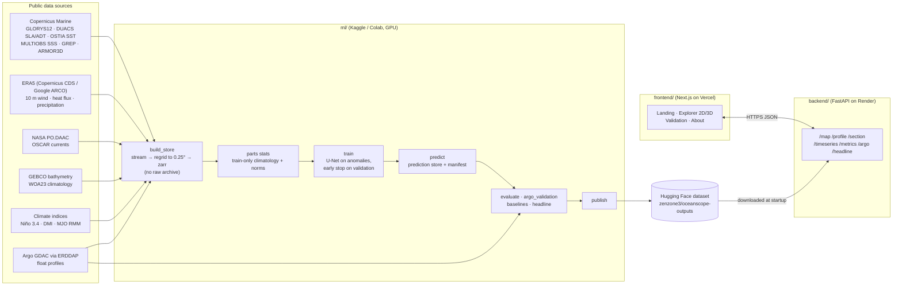

# OceanScope AI

**See the ocean below the surface.** OceanScope AI reconstructs daily sea temperature at 15 depths, from the surface down to about 1,060 m, across the North Indian Ocean. It uses only what satellites and a few other sources can see from the surface, plus recent ARGO float profiles. You can explore the result as a 2D map or a 3D cutaway block.

- **Live site:** https://ocean-embed.vercel.app
- **API:** https://oceanscope-backend.onrender.com/api/v1 (OpenAPI schema in [`backend/openapi.json`](backend/openapi.json))
- **Published outputs:** Hugging Face dataset [`zenzone3/oceanscope-outputs`](https://huggingface.co/datasets/zenzone3/oceanscope-outputs)
- **Model run shown:** `main2_ft`

> **Honest caveat, up front.** The model is trained to reproduce the GLORYS12 reanalysis. GLORYS assimilates satellite altimetry and ARGO profiles, so agreement with GLORYS is not the same as agreement with the real ocean. ARGO profiles are also assimilated into GLORYS, so our ARGO comparison is not fully independent either. See [Limitations](#limitations).

---

## Why this matters

Satellites measure the sea surface every day, but most of the ocean's heat sits below it, where the only direct measurements are sparse: a few thousand ARGO floats worldwide, each profiling about every 10 days. The layer between 50 and 300 m holds the thermocline, which steers cyclone strength, monsoon rainfall and fisheries in the Bay of Bengal and the Arabian Sea. OceanScope fills in that layer every day from surface observations, with a small neural network and an honest scorecard.

## What it does

| | |
|---|---|
| **Region** | 40–100°E, 0–30°N (Arabian Sea, Bay of Bengal, northern equatorial Indian Ocean) |
| **Grid** | 0.25°, daily |
| **Depths** | 15 native GLORYS12 levels: 0.5, 5, 10, 18, 29, 47, 66, 92, 131, 186, 222, 266, 380, 644 and 1,062 m (7 of them in 50–300 m) |
| **Period** | Train 1993-03-02 to 2017-12-01 · Validation 2018-01-01 to 2020-12-01 · Test 2021 (sealed until the final test) |
| **Model** | Small 2D U-Net (≤ 10 M parameters) that predicts temperature anomalies from a training-period climatology |
| **Headline test** | Bay of Bengal, 50–300 m: is the model's error against held-out ARGO floats lower than GLORYS12, the GREP ensemble mean and ARMOR3D? Fixed before training (see [Results](#results)) |

### On the site

- **Landing page:** a woodblock-print scene; "Dive" takes you into the Explorer.
- **Explorer, 2D map:** temperature at any date and depth, the GLORYS reference, or the error between them. Click a point for its depth profile and time series.
- **Explorer, 3D cutaway:** the region as a block hanging under the map, with the selected depth as the top face, the water column on the walls, 2 °C contours and the 20 °C isotherm. Includes a depth rail, an exploded-layers mode and a guided tour. Desktop and tablet only; phones get the 2D map.
- **Validation page:** metrics per depth, season and region, ARGO comparisons and the headline card (it says "Not met" if the result isn't met).
- **Coming next, "Talk to the ocean":** an AI guide built on Meta's models (Muse Spark, Muse Voice Transcribe, Muse Image, SAM 3.1) that answers questions from the data and moves the map for you, plus an event time machine, postcards and a lasso tool. The backend for the guide is written and tested but not yet deployed, and none of it is in this release.

---

## Results

**Run `main2_ft`**: the U-Net trained on 23 training years (1993–2017 without 2005 and 2006, which weren't built in time), then fine-tuned on ARGO profiles from floats that are not held out (λ = 0.3, picked on validation).

**Validation, 2018–2020, against GLORYS12:** RMSE **0.660 °C**, which is **33.5% skill** over the climatology baseline.

**Headline test (Bay of Bengal, 50–300 m, held-out ARGO floats, validation years):**

| Product | RMSE vs held-out floats (°C) |
|---|---|
| OceanScope `main2_ft` | 0.996 |
| GLORYS12 | 0.786 |
| GREP ensemble mean | 0.952 |
| ARMOR3D | 0.607 |

**Verdict: not met.** The model is level with the GREP mean (the difference isn't significant), but GLORYS12 and ARMOR3D are closer to the floats. We fixed this test before training and report it as it came out. ARGO fine-tuning brought the model's error down from 1.026 °C (`main2`) to 0.996 °C.

The sealed 2021 test year has not been scored yet; it runs once, at the end. The per-depth, per-season and per-region tables are in the published dataset under `metrics/` and on the site's Validation page.

---

## How it works



**Data.** Each product is streamed from its provider, reduced straight away to the 0.25° grid and the 15 depths, and written to a processed zarr store, one year at a time. No raw archive is kept, which keeps the full 1993–2021 build at about 20 GB instead of about 1 TB. The build runs as parallel Kaggle notebooks, one part per range of years, and a separate step fits the training-only climatology and normalisation statistics across the parts.

**Inputs (143 channels by default).** For each day the model sees the last 7 days of sea-level anomaly and absolute dynamic topography, SST, SSS, surface currents, 10 m winds and wind-stress curl, net heat flux and precipitation. It also sees a 60-day sea-level history (which carries the slow ocean waves that move the thermocline), daily climate indices (Niño 3.4, the Indian Ocean Dipole and the MJO), recent ARGO profiles from floats that are *not* held out, bathymetry, the WOA23 climatological profile, and position and season.

**Target.** The GLORYS12 temperature anomaly at the 15 depths, relative to a training-period climatology and scaled per depth. The GREP ensemble mean is an auxiliary target. The loss counts the 50–300 m band twice as much.

**Model.** A plain 2D U-Net: 3×3 convolutions with GroupNorm and SiLU, skip connections and a 1×1 output to 15 depths. It has at most 10 M parameters and no attention. It trains with mixed precision, resumes from a checkpoint after a disconnect, and selects the best model on validation RMSE in °C only.

**Evaluation.** Baselines are climatology and per-pixel ridge regression. Metrics are computed per depth, season and region, with day-to-day flicker and per-year bias checks and physics sanity checks. Comparisons against ARGO use 20% of floats held out at the float level, which never feed the model as input. The test year (2021) is sealed: one command scores it once, on the owner's instruction, and the result is fixed after that.

**Serving.** The backend downloads the active run from Hugging Face at startup and serves maps, profiles, sections and metrics. A GitHub Actions job pings it every 10 minutes so the free Render instance stays awake.

---

## Reproduce it

You need Python 3.11, Node 22 with pnpm, and free accounts for Copernicus Marine, NASA Earthdata, Copernicus CDS and Hugging Face. Credentials are read only from environment variables or notebook secrets.

### 1. Run the site locally on synthetic data (no accounts needed)

The repo ships contract-exact synthetic outputs in `fixtures/sample_outputs/` (labelled `synthetic: true`; the site shows a SYNTHETIC banner).

```bash
# backend
cd backend
pip install -e ".[dev]"
DATA_DIR=../fixtures/sample_outputs uvicorn app.main:app --port 7860

# frontend, in another terminal
cd frontend
pnpm install
NEXT_PUBLIC_API_BASE_URL=http://localhost:7860/api/v1 pnpm dev   # http://localhost:3000
```

To run the frontend with no backend at all, set `NEXT_PUBLIC_USE_MOCKS=true`.

Working on the frontend? Start with [`frontend/README.md`](frontend/README.md): Node and pnpm versions, `.env.local` setup (deployed backend, mocks or local fixtures), checks, the Meta feature flags, and the branch and PR flow.

### 2. Build the data store (Kaggle or Colab)

Set the secrets `COPERNICUSMARINE_SERVICE_USERNAME`, `COPERNICUSMARINE_SERVICE_PASSWORD`, `EARTHDATA_USERNAME`, `EARTHDATA_PASSWORD` and `CDSAPI_KEY`, then from `ml/`:

```bash
pip install -e .
# one part per range of years; run parts in parallel notebooks
python -u -m oceanscope_ml.data.build_store --config configs/experiment.yaml \
    --years 1993-1999 --part --out-dir <out> --scratch-dir /tmp/scratch --stream --static-file <static_fields.nc>
# fit train-only climatology and normalisation stats across all parts, then check every year
python -m oceanscope_ml.data.parts stats --parts <A.zarr> <B.zarr> ... --out stats.zarr
python -m oceanscope_ml.data.parts check --parts <A.zarr> <B.zarr> ... --stats stats.zarr
```

`build_store --dry-run --years 2019` prints each remote request and its estimated size without downloading anything. A year that is cut off is redone on the next run; finished years are skipped. Expect about 1 to 4 hours per year, mostly GLORYS and (for 2018–2021) ARMOR3D.

### 3. Baselines, training, prediction and evaluation (GPU)

On Kaggle, with the part stores attached as inputs, GPU and Internet on and an `HF_TOKEN` secret, one script runs stats, training, prediction, evaluation, baselines and (with `OCEANSCOPE_PUBLISH=1`) publishing: `%run ml/scripts/kaggle_train_and_publish.py`. `ml/scripts/kaggle_finetune.py` runs the ARGO fine-tune and `ml/scripts/kaggle_argo_check.py` the ARGO comparison. The steps it runs are:

```bash
STORES="<A.zarr> <B.zarr> <C.zarr> <D.zarr>"
python -m oceanscope_ml.models.baselines --config configs/experiment.yaml --store $STORES --stats stats.zarr
python -m oceanscope_ml.train --config configs/experiment.yaml --store $STORES --stats stats.zarr --run-id <run_id>
python -m oceanscope_ml.inference.predict --config configs/experiment.yaml --store $STORES --stats stats.zarr \
    --checkpoint checkpoints/<run_id>/best.pt
python -m oceanscope_ml.evaluation.evaluate --config configs/experiment.yaml \
    --predictions outputs/predictions/predictions_<run_id>.zarr --store $STORES --stats stats.zarr
python -m oceanscope_ml.data.download --config configs/experiment.yaml --products argo \
    --start 2018-01-01 --end 2020-12-31 --out-dir raw
python -m oceanscope_ml.evaluation.argo_validation --config configs/experiment.yaml \
    --predictions outputs/predictions/predictions_<run_id>.zarr --store $STORES --stats stats.zarr \
    --argo raw/argo/*.nc --holdout argo_eval_floats.json
```

Training resumes automatically if you run the same command with the same `--run-id`. All settings (region, depths, dates, splits, hyperparameters) live in [`ml/configs/experiment.yaml`](ml/configs/experiment.yaml).

The final test on 2021 runs **once**, only on the owner's go: `python -m oceanscope_ml.evaluation.final_test ... --owner-go`.

### 4. Publish and deploy

```bash
python -m oceanscope_ml.publish --config configs/experiment.yaml --dry-run   # lists what would upload
HF_TOKEN=... python -m oceanscope_ml.publish --config configs/experiment.yaml
```

`manifest.json` is uploaded last, so the backend never sees a half-published run. The backend is a Docker web service on Render ([`render.yaml`](render.yaml)) that reads `HF_DATASET_REPO` and `HF_DATASET_REVISION`. The frontend deploys to Vercel with `NEXT_PUBLIC_API_BASE_URL` set to the backend.

### Checks

```bash
cd ml       && ruff check . && ruff format --check . && mypy src && pytest -q
cd backend  && ruff check . && ruff format --check . && mypy app && pytest -q && python -m app.export_openapi --check
cd frontend && pnpm typecheck && pnpm lint && pnpm test && pnpm build
```

Tests never read the test year.

---

## Repository layout

```
ml/         Python package oceanscope_ml: data build, models, training, evaluation, inference, publish
backend/    FastAPI app, Dockerfile, openapi.json, tests
frontend/   Next.js app (landing, Explorer 2D/3D, validation, about)
fixtures/   synthetic, contract-exact sample outputs for development (< 5 MB)
docs/       PRDs, DECISIONS.md, PHASES.md, OPEN_QUESTIONS.md, PROGRESS.md, reviews
```

Rules for contributors and coding agents are in [`AGENTS.md`](AGENTS.md). Design decisions, with dates and who approved them, are in [`docs/DECISIONS.md`](docs/DECISIONS.md).

---

## Limitations

- **Trained to imitate a reanalysis.** The target is GLORYS12, which itself assimilates altimetry and ARGO. Skill against GLORYS is not skill against the real ocean. The ARGO comparison is the closer check, but ARGO is assimilated into GLORYS too, so it is not fully independent.
- **The headline test was not met.** Against held-out ARGO floats in the Bay of Bengal at 50–300 m, GLORYS12 and ARMOR3D are more accurate than our model; we only tie the GREP mean.
- **Training years.** 2005 and 2006 were not built in time and are not in the training set.
- **Before 2004**, there are few ARGO floats, so the ARGO input channels are empty by design for those years.
- **Not tuned exhaustively.** Two full training runs and one ARGO fine-tune, with no hyperparameter search. The per-input-group ablation study planned in the PRD hasn't been run, so we make no claim about which inputs matter most.
- **Test year not scored yet.** All numbers above are on the 2018–2020 validation years.
- **Resolution.** 0.25° and daily. Fronts, eddies and coastal features smaller than about 25 km are smoothed out, and cells less than half ocean are masked.
- **Depth.** 15 levels down to about 1,060 m. Values between levels in the profile chart are interpolated for display only.
- **Region.** The North Indian Ocean box only (40–100°E, 0–30°N). The model has not been tested elsewhere.
- **Not a forecast.** Each map is a reconstruction of a past day from that day's and earlier observations.
- **No live maps yet.** The site covers past dates only; daily near-real-time updates are planned.
- **Hosting.** The backend runs on Render's free tier (512 MB). After a restart it re-downloads the data, which takes a few minutes.

---

## Data credits

OceanScope AI is built entirely on open data. Thank you to everyone who collects, processes and shares it.

- **E.U. Copernicus Marine Service:** GLORYS12 reanalysis (`GLOBAL_MULTIYEAR_PHY_001_030`), DUACS sea level (`SEALEVEL_GLO_PHY_L4_MY_008_047`), OSTIA SST (`SST_GLO_SST_L4_REP_OBSERVATIONS_010_011`), multi-observation SSS (`MULTIOBS_GLO_PHY_S_SURFACE_MYNRT_015_013`), GREP ensemble (`GLOBAL_MULTIYEAR_PHY_ENS_001_031`) and ARMOR3D (`MULTIOBS_GLO_PHY_TSUV_3D_MYNRT_015_012`). *"This study has been conducted using E.U. Copernicus Marine Service Information."*
- **ERA5**, Copernicus Climate Change Service (C3S) at ECMWF, accessed through the Copernicus Climate Data Store and Google's public ARCO-ERA5 copy. *"Contains modified Copernicus Climate Change Service information."*
- **OSCAR** ocean surface currents, Earth & Space Research, distributed by NASA PO.DAAC.
- **Argo** float data. *"These data were collected and made freely available by the International Argo Program and the national programs that contribute to it (https://argo.ucsd.edu, https://www.ocean-ops.org). The Argo Program is part of the Global Ocean Observing System."* Argo (2000), Argo float data and metadata from Global Data Assembly Centre (Argo GDAC), SEANOE, https://doi.org/10.17882/42182. Accessed through ERDDAP.
- **GEBCO** Compilation Group, GEBCO 2023 Grid.
- **World Ocean Atlas 2023**, NOAA National Centers for Environmental Information.
- **Niño 3.4 index**, NOAA Climate Prediction Center. **MJO RMM index** (Wheeler and Hendon, 2004), Australian Bureau of Meteorology. The Indian Ocean Dipole index is computed by us from OSTIA.
- **Basemap:** OpenFreeMap, with map data © OpenStreetMap contributors.

## Built by

Aryan, with Claude (planning, review and code) and Gemini (implementation).
