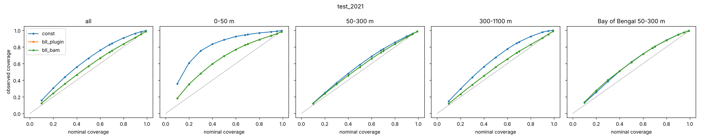

# Are OceanScope's error bars honest?

OceanScope AI is a U-Net that predicts daily ocean temperature at 15 depths (0–1062 m) over the North Indian Ocean on a 0.25° grid. This page tests a basic uncertainty version of it against Argo floats the model never saw. The model is `main3_aix30a`, trained on 1993–2017.

## The method in short
- **Frozen U-Net.** The trained model is not changed.
- **Bayesian last layer, one per depth.** It takes the 32 features that feed the U-Net's final 1×1 layer, whitened to their 8 leading directions and clipped to the range seen in fitting. From those it predicts the size of the model's error at each point, with a small mean correction.
- **Fitted with Batch-and-Match.** The posterior is fitted with Batch-and-Match (Cai, Modi et al., ICML 2024), a score-based variational inference method, started from the Laplace approximation. At every depth it converged to within 0.35 Laplace sd of the MAP.
- **A cap on width.** The error size the layer predicts is capped at 3× the constant bar.
- **Baseline.** One constant error size per depth: the RMS error on the fitting floats.
- **Data.** Only the 20% of Argo floats held out from all model inputs are used.
- **Code.** [`ml/src/oceanscope_ml/evaluation/uncertainty.py`](../../ml/src/oceanscope_ml/evaluation/uncertainty.py)

## What was fitted on what
- **Fitting.** Everything is fitted on **2018–2020**: 51 held-out floats, 3,848 profiles.
- **Choosing settings.** The settings (feature directions, clipping, cap, mean correction) were picked on a split *inside* 2018–2020: fit on 26 floats, score the other 25. The rule was written down before each round ([SELECTION.md](SELECTION.md)).
- **2021 as a confirmation, not a clean test.** The final setting was run on **2021**: 23 floats, 752 profiles, 269,303 observations. 2021 has now been viewed four times:
  1. the model's one-shot accuracy test;
  2. a first error-bar run whose fit had not converged (its constant-bar coverage was seen);
  3. the first converged version (68% / 95% coverage 0.71 / 0.94);
  4. this final run.

  The final settings were fixed on 2018–2020 by a rule written down before each selection round. Nothing was ever fitted on 2021. But those rounds came after looks 2 and 3, so read the 2021 numbers as a confirmation.
- **Sample sizes are small.** There are 23 floats in 2021, and only 7 in the Bay of Bengal. The bootstrap intervals over floats below are correspondingly wide.

## 2021 results

| region / depth | error bar | 68% interval holds | 95% interval holds | mean sd (°C) | CRPS (°C) | CRPS gain vs constant |
|---|---|---|---|---|---|---|
| all, 23 floats | constant | 0.83 | 0.98 | 0.49 | 0.220 | — |
| | **Bayesian last layer** | **0.74** (0.69–0.77) | **0.95** (0.94–0.97) | **0.40** | **0.207** | **5.7%** (4.3–7.3) |
| 0–50 m | constant | 0.95 | 0.99 | 0.96 | 0.298 | — |
| | **last layer** | **0.82** | **0.96** | **0.58** | **0.244** | **18%** (11–24) |
| 50–300 m | constant | 0.76 | 0.96 | 0.72 | 0.380 | — |
| | **last layer** | **0.73** | **0.95** | **0.69** | **0.363** | **4.4%** (2.5–6.1) |
| 300–1100 m | constant | 0.85 | 0.99 | 0.32 | 0.132 | — |
| | **last layer** | **0.73** | **0.95** | **0.25** | **0.127** | **4.1%** (−0.2 to 8.5) |
| Bay of Bengal 50–300 m, 7 floats | constant | 0.79 | 0.97 | 0.78 | 0.371 | — |
| | **last layer** | **0.79** | **0.97** | **0.77** | **0.355** | **4.2%** (2.6–5.5) |

Brackets are 95% bootstrap intervals over floats. Gaussian NLL (all depths) is 0.277 for the last layer and 0.382 for the constant bar. Full tables: [scores_2021.csv](scores_2021.csv).

**How to read it:**
- **The constant bar is honest but blunt.** It never under-covers, but it is far too wide near the surface (its "68%" interval holds 95% of the time), because one size per depth ignores where errors are large.
- **The last layer is sharper and still honest.** Its bars are 18% narrower on average, its 95% intervals hold 95% of the time, and its CRPS is lower in every band (the 300–1100 m interval just touches zero).
- **The Bay of Bengal is still conservative.** At 50–300 m both methods cover more than nominal, so there the bars are somewhat too wide. The learned bars there are barely different from the constant ones (mean sd 0.77 vs 0.78 °C), so the CRPS gain is modest.
  - **It isn't the fixes.** Clipping and the cap hit Bay of Bengal floats *less* than elsewhere: 1.2% of its 50–300 m observations on the 2018–2020 split, against 10.5% for other 50–300 m observations, and none in 2021.
  - **It isn't the setting either.** In every one of the 27 settings tried on 2018–2020, the Bay of Bengal bars averaged 0.86–0.92 °C, against 0.89 for the constant bar.
  - **What it is.** The layer, fitted on all regions at once (only 9 Bay of Bengal floats in 2018–2020), does not find features that separate easy from hard conditions there. Keeping bars sharp in a small, unusual region without letting them blow up is the open thin-data problem.

## What happens when inputs drift outside the fit
- **What we saw.** In the first version, fitted on half the 2018–2020 floats, about 3.5% of the other half's observations got error bars more than 5× the constant one, mostly at 380–640 m.
- **What was really going on.** The actual errors at those points were about 2× larger than usual, so the model was right that they are harder. It just overshot.
- **The fixes.** Three, all chosen on the 2018–2020 split:
  - keep 8 feature directions instead of 32;
  - clip features to the range seen in fitting;
  - cap any error bar at 3× the constant one.
- **Result.** No observation is now above 5×. The cap is active on 3.0% of observations in the 2018–2020 split and 0.04% in 2021.
- **2018–2020 split result:** coverage 0.74 / 0.95, with CRPS 7.8% (5.4–9.5) better than the constant bar ([scores_2018_2020_halves.csv](scores_2018_2020_halves.csv)).

## What Batch-and-Match adds here
- **Coverage and CRPS barely change.** The full BaM posterior and its mean alone give almost the same coverage and CRPS, because with 1,500–3,700 profiles per depth the parameter uncertainty is small next to the noise.
- **NLL is where it shows, and the gain sits where features extrapolate.** On the 2018–2020 split, the full posterior's NLL is 0.73 against 2.16 for the posterior mean alone. The breakdown:
  - **Where features are clipped or the bar is capped** (7.1% of observations): 4.0 vs 24.1.
  - **Everywhere else:** 0.478 vs 0.484.
  - **Medians:** 0.363 vs 0.361.
  - **Concentration:** 99% of the difference comes from 0.1% of observations.

  So BaM's averaging over parameters matters almost only where inputs leave the fitted range, which is the thin-data case. On those extrapolating rows even BaM's NLL (4.0) is worse than the constant bar's (2.6).
- **Where it matters most.** The parameter uncertainty would matter much more with fewer data, such as one region or season, or a handful of subjects.

## Caveats
- Observations from one float are correlated in time. The fit uses one observation per profile and depth, and the intervals resample whole floats.
- The error bars are against Argo point measurements, so they include the gap between a point and a 0.25° cell.
- One input to the model, ARMOR3D, assimilates all Argo floats, including the held-out ones. Errors at the floats are therefore smaller than they would be for a model fully independent of them.
